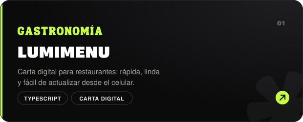
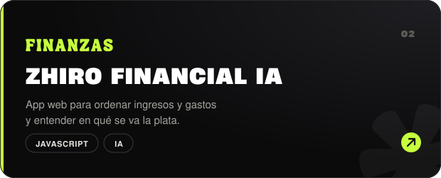
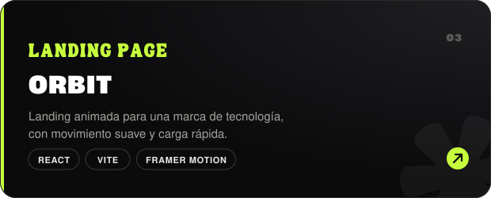
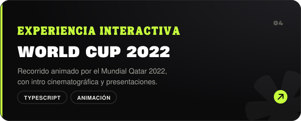

  
  
  

Soy cofundador de **[F\*CK](https://somosfuck.com)**, agencia creativa de Buenos Aires. Hago **webs, tiendas online y sistemas de gestión** para comercios: que te escriban, que te compren y que el negocio se ordene.

Antes de programar trabajé años en comercio, de vendedor a encargado de local. Por eso armo herramientas pensando en quien atiende el mostrador.

  

Formación full stack en Coderhouse: Desarrollo Web · JavaScript · React · Backend I, II y III

  
  
  
  

Los proyectos de clientes de F*CK son privados. Mirá el trabajo en <a href="https://somosfuck.com">somosfuck.com</a>.

<picture>
  <source media="(prefers-color-scheme: dark)" srcset="https://raw.githubusercontent.com/crissacio/crissacio/output/snake-dark.svg">
  <source media="(prefers-color-scheme: light)" srcset="https://raw.githubusercontent.com/crissacio/crissacio/output/snake.svg">
  
</picture>

  

